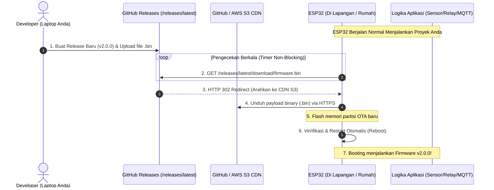

# 🚀 ESP32 Universal GitHub OTA Framework

[](https://opensource.org/licenses/MIT)
[](https://www.espressif.com/en/products/socs/esp32)
[](https://www.espressif.com/en/products/socs/esp8266)
[](https://www.arduino.cc/)
[](https://github.com/farelgilang855-netizen/esp32-ota/releases)

**ESP32 Universal GitHub OTA Framework** adalah template/boilerplate *production-ready* untuk memperbarui firmware perangkat **ESP32 & ESP8266** dari jarak jauh (**Over-The-Air / OTA**) menggunakan **GitHub Releases** sebagai cloud server distribusi firmware gratis dan andal.

Didesain secara modular agar dapat **diintegrasikan ke proyek IoT apa pun**—mulai dari sistem sensor, kontrol relay, Smart Home (MQTT / Home Assistant), Modbus SCADA industri, Web Server lokal, hingga proyek lampu dekoratif.

---

## 📌 Daftar Isi

- [Mengapa GitHub Releases untuk OTA?](#-mengapa-github-releases-untuk-ota)
- [Arsitektur & Alur Kerja](#-arsitektur--alur-kerja)
- [Struktur & Contoh Program yang Disediakan](#-struktur--contoh-program-yang-disediakan)
- [Integrasi Cepat ke Proyek Anda (3 Menit)](#-integrasi-cepat-ke-proyek-anda-3-menit)
- [Pengaturan Partisi Memori (Untuk Proyek Besar)](#-pengaturan-partisi-memori-untuk-proyek-besar)
- [Alur Kerja Rilis Firmware (Release Workflow)](#-alur-kerja-rilis-firmware-release-workflow)
- [Opsi Lanjut: Multitasking FreeRTOS (Dual Core)](#-opsi-lanjut-multitasking-freertos-dual-core)
- [Troubleshooting & FAQ](#-troubleshooting--faq)
- [Lisensi](#-lisensi)

---

## 💡 Mengapa GitHub Releases untuk OTA?

Banyak developer IoT kesulitan saat harus melakukan update perangkat di lapangan karena biasanya membutuhkan server hosting sendiri (seperti VPS, AWS EC2, atau PHP/Node.js script).

Dengan memanfaatkan GitHub Releases:
1. **100% Gratis & Tanpa Server**: Memanfaatkan infrastruktur global GitHub dan Amazon S3 CDN tanpa biaya sewa server.
2. **Link Ajaib `/releases/latest/`**: ESP32 tidak perlu tahu versi berapa yang akan datang. Endpoint `latest` akan selalu mengarah ke rilis terbaru secara otomatis.
3. **Manajemen Versi & Rollback**: Setiap versi firmware tersimpan rapi sebagai arsip. Jika versi baru memiliki *bug*, Anda dapat dengan mudah melakukan rollback ke versi sebelumnya.
4. **Keamanan SSL & Redirect Support**: Firmware diunduh melalui protokol HTTPS terenkripsi.

---

## 🔄 Arsitektur & Alur Kerja



---

## 📂 Struktur & Contoh Program yang Disediakan

Repositori ini menyediakan 2 template siap pakai:

| File Program | Deskripsi | Cocok Digunakan Untuk |
| :--- | :--- | :--- |
| **[`esp32_github_ota_universal.ino`](./esp32_github_ota_universal.ino)** | **Template Inti Polos (Universal)**: Arsitektur modular dengan pemisahan jelas antara mesin OTA dan fungsi pengguna (`userSetup()`, `userLoop()`). | Proyek IoT sungguhan (Sensor, Modbus, MQTT, Relay, Smart Home). |
| **[`esp32_github_ota_rgb.ino`](./esp32_github_ota_rgb.ino)** | **Demo Visual**: Implementasi OTA pada lampu LED RGB dengan algoritma *Rainbow Fade* (HSV to RGB) sebagai bukti visual pembaruan berhasil. | Pembelajaran, demonstrasi visual, atau lampu dekoratif pintar. |

---

## ⚡ Integrasi Cepat ke Proyek Anda (3 Menit)

Jika Anda sudah memiliki program ESP32 yang sedang dikembangkan dan ingin menambahkan fitur GitHub OTA, gunakan pola arsitektur berikut:

```cpp
#include <WiFi.h>
#include <WiFiClientSecure.h>
#include <HTTPUpdate.h>

// 1. Masukkan Kredensial WiFi & Link Release Latest
const char* WIFI_SSID     = "NAMA_WIFI";
const char* WIFI_PASSWORD = "PASSWORD_WIFI";
const char* FIRMWARE_URL  = "https://github.com/USERNAME/REPO/releases/latest/download/NAMA_PROGRAM.ino.bin";

// 2. Timer Non-blocking (Cek setiap 1 jam untuk produksi)
unsigned long lastOTACheck = 0;
const unsigned long CHECK_INTERVAL = 3600000; // 1 Jam (3600000 ms)

void setup() {
  Serial.begin(115200);
  WiFi.begin(WIFI_SSID, WIFI_PASSWORD);
  
  // === INIT KODE PROYEK ANDA DI SINI ===
  // inisialisasiSensor();
  // inisialisasiRelay();
  // inisialisasiMQTT();

  // Cek update 1x saat pertama menyala
  checkAndUpdate();
}

void loop() {
  // === LOGIKA UTAMA PROYEK ANDA ===
  // bacaSensor();
  // kirimDataKeCloud();
  // kontrolMesin();

  // === TIMER OTA DI LATAR BELAKANG ===
  if (millis() - lastOTACheck >= CHECK_INTERVAL) {
    lastOTACheck = millis();
    checkAndUpdate();
  }
}

// 3. Mesin Eksekusi OTA
void checkAndUpdate() {
  if (WiFi.status() == WL_CONNECTED) {
    WiFiClientSecure client;
    client.setInsecure(); // Bypass verifikasi sertifikat SSL root
    httpUpdate.setFollowRedirects(HTTPC_STRICT_FOLLOW_REDIRECTS);
    
    t_httpUpdate_return ret = httpUpdate.update(client, FIRMWARE_URL);
    if (ret == HTTP_UPDATE_OK) {
      ESP.restart(); // Otomatis reboot setelah update berhasil
    }
  }
}
```

---

## 💾 Pengaturan Partisi Memori (Untuk Proyek Besar)

Agar ESP32 dapat melakukan OTA, chip memori Flash harus dibagi menjadi minimal 2 partisi aplikasi: **Partisi Berjalan (*App0*)** dan **Partisi Cadangan (*App1*)**. Saat file baru diunduh, ia akan ditulis ke *App1*. Setelah selesai dan valid, penunjuk boot dipindahkan ke *App1*.

Untuk program yang menggunakan library besar (seperti Firebase, WebServer, Bluetooth, atau Layar TFT):
1. Buka Arduino IDE.
2. Masuk ke menu **Tools** ➔ **Partition Scheme**.
3. Pilih:
   - **`Minimal SPIFFS (Large APPS with OTA)`** (Menyediakan ~1.9MB untuk kode program).
   - Atau **`No OTA (Large APP)`** jika Anda ingin memaksimalkan memori tanpa OTA.

---

## 🛠️ Alur Kerja Rilis Firmware (Release Workflow)

Setelah kode dasar di-flash ke ESP32 menggunakan kabel USB untuk pertama kali, ikuti siklus ini untuk pembaruan berikutnya:

```text
[Ubah Kode di Laptop] ➔ [Export .bin] ➔ [Upload ke GitHub Release] ➔ [ESP32 Auto-Update]
```

### 1. Kompilasi Binary
- Di Arduino IDE, klik menu **Sketch** ➔ **Export compiled Binary** (`Ctrl + Alt + S`).
- Buka folder sketch Anda. Ambil file utama yang berakhiran:
  👉 **`<nama_program>.ino.bin`**
- *Abaikan file yang ada embel-embel `.bootloader.bin` atau `.partitions.bin`.*

### 2. Publikasikan di GitHub Releases
- Masuk ke repository GitHub Anda.
- Klik **Releases** ➔ **Draft a new release**.
- Tentukan Tag baru (misal: `v2.0.0`, `v3.0.0`).
- Seret (*drag & drop*) file `.bin` Anda ke kotak **"Attach binaries by dropping them here"**.
- Klik **Publish release**.

Dalam waktu interval yang ditentukan, ESP32 Anda akan otomatis mengunduh program baru tersebut melalui internet!

---

## 🧠 Opsi Lanjut: Multitasking FreeRTOS (Dual Core)

Untuk sistem industri yang tidak boleh berhenti sedetik pun saat proses unduh OTA berlangsung, Anda dapat memanfaatkan **Dual Core** ESP32 menggunakan FreeRTOS:

- **Core 1**: Menjalankan kontrol mesin, pembacaan sensor berkecepatan tinggi, atau komunikasi Modbus/CAN bus secara *real-time*.
- **Core 0**: Dikhususkan untuk menangani WiFi stack dan proses pengunduhan OTA di latar belakang.

*(Lihat implementasi `xTaskCreatePinnedToCore()` di forum komunitas ESP32 jika proyek Anda membutuhkan isolasi core penuh).*

---

## ❓ Troubleshooting & FAQ

| Pertanyaan / Gejala | Penyebab | Solusi |
| :--- | :--- | :--- |
| **Error `HTTP_UPDATE_FAILED (-1)`** | Link redirect GitHub tidak diikuti atau SSL diblokir | Pastikan baris `client.setInsecure();` dan `httpUpdate.setFollowRedirects(HTTPC_STRICT_FOLLOW_REDIRECTS);` sudah terpasang. |
| **ESP32 gagal download file rilis baru** | Nama file di GitHub berbeda dengan di kode | Pastikan nama file `.bin` yang di-upload ke Release sama persis dengan nama file di variabel `FIRMWARE_URL`. |
| **ESP32 bootloop saat mengunduh** | Tegangan listrik drop saat WiFi transmit daya tinggi | Gunakan adaptor/power supply minimal 5V 1A berkualitas baik (hindari port USB laptop yang arusnya terbatas). |
| **Apakah bisa untuk ESP8266?** | ESP8266 menggunakan library berbeda | Bisa! Gunakan `#include <ESP8266httpUpdate.h>` dan library `<ESP8266WiFi.h>`. |

---

## 📄 Lisensi

Proyek ini dirilis di bawah lisensi [MIT License](./LICENSE). Anda bebas menggunakannya untuk proyek pribadi, edukasi, maupun produk komersial.
